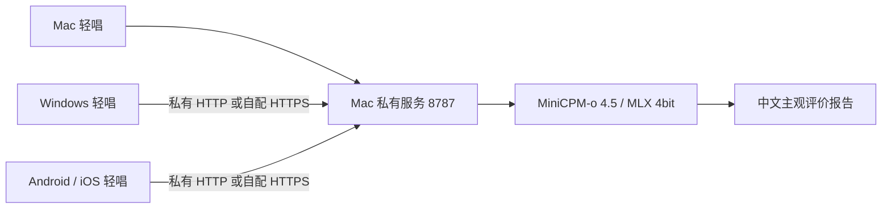

# AI评分与本地部署

> 历史方案：MiniCPM 已停用，本文仅保留既往记录；请勿按本文启动旧服务。当前方案见[评分方案](./评分方案.md)，原生包本轮未重打包。

## 当前状态与评价范围

轻唱已接入真实 MiniCPM-o 4.5 听音评价。当前已完成固定版本模型校验、加载与 `mx.eval`、HTTP 听音和桌面/手机宽度 UI 闭环：真人清唱可获得反馈，器乐与噪声被拒评，静音预检明确不调用模型。上述结果不等于评分已校准，也不代表 Android/iPhone 真机或真人现场录音质量已验收，详细证据见[验收记录](./验收记录.md)。

报告评价四项主观听感：清晰度、稳定感、表现力、录音质量。没有标准旋律、曲谱和对齐标签，无法据此量化逐音音准、断定某个音符跑调或判断与原唱的一致性。实时音高参考与 AI 主观评价是两种不同功能，二者都不生成有标准答案的歌曲音准分数。

应用优先提交新作品单独保存的原始干声；旧作品如果没有干声，则使用混音作品并以 `inputKind: 'mixed'` 明确标识。伴奏、音色滤镜、混响和录音环境都可能影响混音听感。服务不得把未调用模型的静音预检结果写成模型推理通过，也不得为纯器乐或人声不足的输入编造演唱分数。

## 部署结构



模型运行在 Apple Silicon Mac。Windows、Android 和 iOS 共享客户端代码，通过配置的服务地址把选定录音交给个人 Mac 推理；模型不在手机内运行，也不随手机或桌面安装包打包。此时音频会从客户端设备传到该 Mac，不能把它描述为手机内部的纯离线推理。

## 模型与存储

使用 [MLX Community 的 MiniCPM-o 4.5 4bit 转换](https://huggingface.co/mlx-community/MiniCPM-o-4_5-4bit)，上游为 [OpenBMB MiniCPM-o 4.5](https://huggingface.co/openbmb/MiniCPM-o-4_5)。本次已下载并校验 14 个文件，共 6,157,966,896 字节，约 6.16 GB，包含双分片权重与配置。下载大小不代表运行时统一内存需求，加载与推理还会使用额外内存。

项目锁定模型版本：`592c09d85e7bffbc8f8e45a417aa8e9a96119814`。`ai_service/model-manifest.json` 保存允许下载的文件和权重 SHA256；安装流程核对 Hub 元数据、文件大小、内容哈希与锁定权重哈希。下载完成不等于模型加载或音频推理成功。

源码运行默认将 Python 环境、模型和缓存放在 `.tools/ai/`；可用 `QINGCHANG_AI_HOME` 指定自己的数据目录。打包的 Mac 应用将 AI 环境置于应用用户数据目录，模型和 Python 虚拟环境不塞进应用安装包。下载需要联网，已完整安装并加载后，推理服务使用本地模型。

## 在 Mac 安装并启动

在 Apple Silicon Mac 的项目根目录：

```sh
npm run ai:setup
npm run ai:start
```

脚本使用独立 Python 3.12 环境和锁定依赖，默认监听 `127.0.0.1:8787`。Mac 客户端填写 `http://127.0.0.1:8787`。`GET /health` 区分 `loading`、`ready` 和 `error`，应等真实模型加载完成后再请求评价；评分接口为 `POST /v1/score`。

Apple Silicon Mac 的 Electron 版本还提供原生 AI 安装与启动入口，后台执行同一套安装和启动逻辑，并显示进度与错误。其他平台通过服务地址连接个人 Mac。

已安装环境会校验运行标记并直接启动，首次或缺少标记时才进入安装；损坏标记会明确报错，不静默重新下载。本次已验证外网不可用时能够使用现有模型启动到 `ready`。应用关闭时只回收自己启动的服务；如果连接的是用户另行启动的既有服务，关闭应用不会终止它。

最终打包的 Mac 应用也完成了受控非静音录音、原生导出和包内模型听音闭环：440 Hz Web Audio MediaStream 经工作室录音后交给真实 MiniCPM，模型将纯音拒评，诊断记录新增且不是静音预检。该输入用于验证链路，不是物理麦克风或真人演唱验收。

## 让自己的手机或 Windows 连接 Mac

客户端和 Mac 位于可互通的私有网络时，先设置自己的访问令牌，再明确允许 Mac 服务对局域网监听：

```sh
QINGCHANG_AI_TOKEN='替换为自己的访问令牌' \
npm run ai:start -- --host 0.0.0.0 --port 8787
```

在客户端填写 Mac 的实际私有地址，例如 `http://192.168.1.10:8787`，并填写相同令牌。手机里的 `127.0.0.1` 指向手机自身，不能用于连接 Mac。服务默认不开启局域网监听，对外监听时要求配置令牌；不要把此个人服务直接暴露到公网。

原生客户端的 HTTP 地址限制为 loopback、RFC1918 私网地址或 `.local`，也允许用户自行配置 HTTPS 服务地址。移动端通过 Capacitor 原生 HTTP 适配上传音频，不通过关闭网页安全设置来取得访问能力。iOS 工程包含受限的私网访问配置，但 iPhone 连接、系统权限和音频路由仍需真机验证。

普通浏览器页面还受浏览器 CORS 和 HTTPS 页面访问 HTTP 服务的限制。服务只接受明确允许的页面来源；网页端遇到来源或混合内容限制时，应使用合适的 HTTPS 部署或原生客户端，不等于可以绕过浏览器安全策略。

## 音频与结果契约

客户端上传真实 WAV、作品 ID、标题、输入类型及可选歌词；元信息只是上下文，不能代替听音证据。服务将音频转换为 16 kHz 单声道；超过 30 秒时选择一段连续高能量片段，并在报告中记录总时长、分析时长和片段起点，不假装听取整首作品。

可评价输入给出四项 0–100 的主观分数和中文建议，总分为四项均值。不可评价输入使用 `scorable: false`，分数为 `null`，说明听到的内容与限制。模型输出不能解析或违反契约时应报错，不能伪造成功报告。

验证至少包括许可明确的真人演唱、纯器乐和静音。真人样本只证明特定录音的听音链路，不建立与专业教师、人类共识或标准音准的一致性。测试素材的来源和转换应保留许可记录，模型输出与真实推理时间应独立记录。

## 本次真人验证素材

真人正样本取自原作者发布的 [VocalSet: A Singing Voice Dataset](https://zenodo.org/records/1442513)，第一方 API 中 `metadata.license.id` 明确为 `cc-by-4.0`。作者与署名为 Julia Wilkins、Prem Seetharaman、Alison Wahl、Bryan Pardo，ISMIR 2018，许可为 [CC BY 4.0](https://creativecommons.org/licenses/by/4.0/)。

取用官方 `VocalSet11.zip` 中 `FULL/female1/excerpts/straight/f1_dona_straight.wav`，为约 20.1405 秒真人清唱片段。使用官方 HTTP Range 读取 ZIP 目录并提取单成员，未下载整个数据集。保留原始 44.1 kHz WAV，另转为 16 kHz 单声道 PCM16，未裁剪、变调或合成人声。转换属于本次改动，应与上述署名一并保留。

测试文件与来源 JSON 位于被忽略的 `.tools/ai-fixtures/`，不随 Git 或应用包分发。原始文件 SHA256 为 `ea67f1c18c59726e1962d6d178f929a31d8c5ddf1662c1b253dc36b083e08efb`，转换文件 SHA256 为 `a1b745325299aa01e414fda140d088146cf705fc514430ff538f8bac76e2ebe5`。器乐负例使用项目原创演示伴奏，静音和噪声由测试程序产生。

## 真实结果与限制

同一段 20.1405 秒清唱的一次 HTTP 请求用时 2.654 秒，得到总分 76.2，四项为 85 / 65 / 75 / 80；独立 UI 请求得到总分 68.8，四项为 80 / 60 / 70 / 65。这证明真实听音与报告展示链路工作，同时说明分数存在波动，不能描述为已校准、稳定可复现或专业音准等级。

给同一录音加入 15 dB SNR 噪声并造成约 2.48% 削波后，模型拒评；更强退化也被拒评，因此没有验证录音质量分数随退化单调下降。模型把这些人工噪声描述为雨声或流水声，表明声景描述可能误判。应把文字建议作为练习参考，而不是客观诊断。

原始 HTTP 与 UI 报告、桌面及手机宽度截图位于 `artifacts/`；完整本机对照记录位于 `.tools/ai/validation/质量对照汇总.json`。手机宽度截图只证明响应式界面，不能代替移动设备权限、音频路由或网络连接的真机验收。
