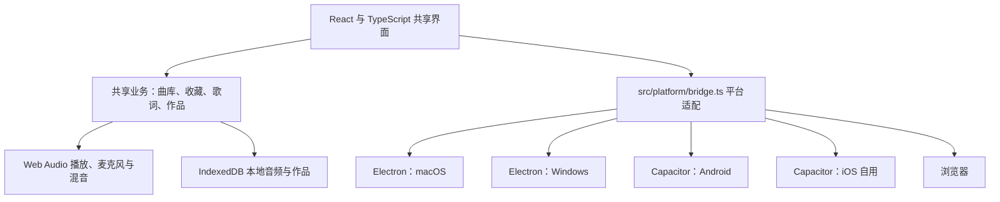

# 跨平台方案

## 一份共享源码，分别构建四端应用

轻唱采用 React + TypeScript 编写共用界面和业务，Web Audio 负责播放、采集与混音，IndexedDB 负责本地曲库和作品。macOS 与 Windows 使用 Electron，Android 与 iOS 使用 Capacitor。四端不复制歌曲管理、录音或歌词业务，各自的文件导出、外链打开和运行环境差异集中在 `src/platform/bridge.ts` 与薄原生容器中。

同一份源码分别生成 macOS 应用、Windows 安装包、Android APK，以及经 Xcode 签名安装到自己 iPhone 的应用；每种产物仍然需要对应平台的构建环境、签名和实机测试。网页版本可直接在支持所需音频 API 的浏览器中运行。

## 构建命令与产物

先在项目目录运行 `npm ci`。通用生产构建命令 `npm run build` 输出共享 Web 资源到 `dist/`。

| 目标 | 开发与构建命令 | 产物或运行方式 |
| --- | --- | --- |
| macOS | `npm run desktop:dev`；`npm run desktop:pack`；`npm run desktop:dist` | 开发窗口、当前架构 `.app` 目录以及 `release/` 下的 DMG；发布需要签名与公证 |
| Windows | 在 Windows 运行同一组 `desktop:*` 命令 | Electron 应用目录以及 `release/` 下的 NSIS 安装程序；需要在 Windows 验证录音、保存和安装 |
| Android | `npm run android:sync`；`npm run android:build` | 同步静态资源和插件后，生成 `android/app/build/outputs/apk/debug/app-debug.apk`；需要 JDK 21 和 Android SDK |
| iOS 自用 | `ios:check` 检查环境；`ios:sync` 同步；`ios:build` 构建模拟器；`ios:run` 选择目标；`ios:open` 打开 Xcode，均通过 `npm run` 调用 | 轻唱要求 iOS 16.4+ 与完整 Xcode 26+；模拟器构建为未签名 App.app，真机需要自己的 Team；本机尚未原生编译 |
| 浏览器 | `npm run dev`；`npm run preview` | 分别运行开发站点和已构建 Web 资源预览；远程录音部署需要 HTTPS |

版本、架构和输出文件名由 `package.json` 的 Electron Builder 配置决定。`desktop:pack` 只生成当前构建系统的可运行目录。上一版已生成 Mac DMG、Windows NSIS 和 Android debug APK；本轮只完善 iOS 支持，没有重新打包这些非目标平台，旧安装包不包含本轮源码改动。Mac 上一版已运行检查，Windows 与手机尚未目标设备验收。Mac 自用包使用 ad-hoc 签名且未公证，Android debug APK 用于开发验收；正式发布需要另行管理对应签名。

## 平台差异

| 能力 | macOS / Windows | Android | iOS 自用 | 浏览器 |
| --- | --- | --- | --- | --- |
| 界面、曲库、歌词与混音 | 共享 TypeScript 实现 | 共享 TypeScript 实现 | 共享 TypeScript 实现 | 共享 TypeScript 实现 |
| 麦克风 | Electron 页面与系统麦克风授权；macOS 包含用途说明 | 原生应用声明录音权限，WebView 请求用户许可 | 配置麦克风用途说明，由系统与 WKWebView 请求用户许可，真机待验 | `getUserMedia`，需要用户许可及 HTTPS 或本地开发地址 |
| 作品导出 | 受限 IPC 调用系统保存对话框，写入用户选定文件 | 写入应用缓存，再交给系统分享或保存入口 | 使用同一 Capacitor 分享桥接，交给系统分享或存储入口，真机待验 | Blob 下载，由浏览器管理下载位置 |
| 外部曲源站点 | 系统浏览器打开 HTTP(S) 地址 | Capacitor 浏览器组件打开 HTTP(S) 地址 | Capacitor 浏览器组件打开 HTTP(S) 地址，真机待验 | 独立浏览器页面打开 |
| 本地数据 | 当前桌面应用的数据目录 | 当前应用的 WebView 存储 | 当前应用的 WKWebView 存储 | 当前站点、当前浏览器配置的数据存储 |
| 音频格式与延迟 | 依赖 Electron 音频实现、系统与设备 | 依赖 Android WebView、系统与设备 | 依赖 WKWebView、系统与设备 | 依赖浏览器、系统与设备 |

本轮共享音频源码增加统一中断入口，接收页面隐藏、原生暂停、正在使用的音频上下文停止运行和输入轨道中断。收到信号后停止当前音频链路，并按已收到的 PCM 保存可用片段；恢复前台不自动重开麦克风。Chrome 受控场景已验证，iPhone 系统中断与 WKWebView 时序仍需真机验收。

共享界面已补安全区、16px 表单字号和至少 44px 的关键触控控件。桌面 WebKit 的持久配置通过音频 / 歌词导入、收藏刷新与手机纵横屏、iPad 模拟视口检查；这些截图和流程不代表 iOS 设备运行。

四端共享源码不会自动同步数据：本期曲库与作品只在当前设备和应用环境中保存，没有账号或云同步。导入支持也以该平台真实解码结果为准。返听与录音延迟需要分别校准，尤其是蓝牙耳机链路。

历史方案曾使用 Apple Silicon Mac 上的 MiniCPM-o 4.5 MLX 私有服务供各端连接，现已停用；原方案保留在[AI评分与本地部署](./AI评分与本地部署.md)。当前实时对比与可选录后评估的方案及限制见[评分方案](./评分方案.md)。

iOS 自用安装可使用 Xcode 的免费 Personal Team，无需上架；免费配置文件会在 7 天后过期，需要重新构建安装。工具要求、账号限制和安装步骤见[苹果手机自用安装](./苹果手机自用安装.md)。

轻唱的 Web 构建目标和 iOS 应用最低部署版本均为 16.4。SPM 依赖包当前由同步工具生成 `.v16`，不改变应用的可安装下限。Capacitor 自身的 iOS 15+ 支持范围不等于本应用承诺的系统范围；本轮不增加旧系统 polyfill。

iOS 工程已加入共享 App scheme、隐私清单及模拟器构建 CI 配置；CI 尚未实际运行。本机检查只发现 Command Line Tools，缺少完整 Xcode 与两个 iOS SDK，因此 `ios:check`、`ios:build` 和 `ios:run -- --list` 明确失败，没有产生 iOS App.app 或 IPA。工具行为、默认输出和个人签名步骤见[苹果手机自用安装](./苹果手机自用安装.md)。

## 验证与当前范围

通用逻辑使用功能级单元测试；浏览器自动化验证真实 Web Audio 与存储流程；原生容器另验静态资源、权限、导出、安装和外链行为。构建通过只能证明该产物可被构建，不能替代设备录音质量验收。当前各平台真实结果见[验收记录](./验收记录.md)。

首期仅做个人 K 歌，不实现账号社区。云端作品发布、合唱、歌曲音准评分与人声分离保留为后续研究方向，见[产品与架构](./产品与架构.md)。
